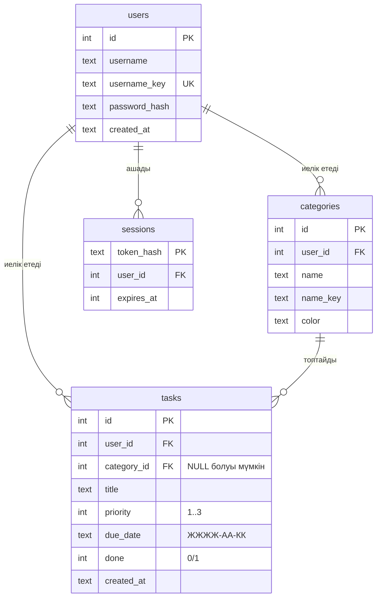

# Тапсырмалар трекері

Санаттары мен мерзімдері бар to-do веб-қосымша (практикалық жұмыс, тақырып №4).
Тіркелу/кіру, әр қолданушының жеке тапсырмалары, санаттар, мерзім, маңыздылық, іздеу және сүзгі.

## Технологиялар

| Бөлім | Таңдау |
|---|---|
| Frontend | HTML, CSS, JavaScript (фреймворксіз), адаптивті, қараңғы режим |
| Backend | Node.js 22+ (кіріктірілген `http` модулі), сыртқы тәуелділіксіз |
| Деректер қоры | SQLite (`node:sqlite`), 4 өзара байланысты кесте |
| Қауіпсіздік | scrypt хэштеу, HttpOnly cookie-сессия, параметрленген SQL, CSP, rate limit |
| Тест | `node:test` (11 тест) |

> Express орнына таза Node.js таңдалды: `npm install` қажет емес, барлық маршрутизация мен
> валидацияны өзіміз жазғандықтан қорғауда әр жолды түсіндіруге болады.

## Іске қосу

```bash
node -v          # 22.5 немесе жоғары болуы керек
npm start        # http://localhost:3000
npm test         # 11 тест
```

Ортa айнымалылары: `PORT` (3000), `DB_PATH` (`data/app.db`), `NODE_ENV=production` (Secure cookie қосады).

## Құрылым

```
server.js          серверді іске қосу
src/app.js         маршруттар, валидация шақыру, статика, қауіпсіздік тақырыптары
src/auth.js        құпия сөз хэші, сессиялар, cookie
src/validate.js    кіріс деректерін тексеру
src/db.js          SQLite схемасы
public/            frontend (index.html, style.css, app.js)
test/api.test.js   API тесттері
docs/              ТЗ, қорғау сұрақтары, ЖИ журналы үлгісі
```

## Деректер қорының сызбасы (ER)



Санат өшірілсе, тапсырмалар сақталады (`ON DELETE SET NULL`). Қолданушы өшірілсе, оның деректері
де өшеді (`ON DELETE CASCADE`).

## API

Барлық `POST/PUT/DELETE` сұраныстарында `X-Requested-With: fetch` тақырыбы қажет (CSRF қорғанысы),
body JSON болуы керек. Тіркелу/кіруден басқа маршруттар жүйеге кіруді талап етеді.

| Әдіс | Маршрут | Сипаттама |
|---|---|---|
| POST | `/api/register` | Тіркелу (`username`, `password`), 3 әдепкі санат жасалады |
| POST | `/api/login` | Кіру |
| POST | `/api/logout` | Шығу |
| GET | `/api/me` | Ағымдағы қолданушы (`user: null`, егер кірмесе) |
| GET | `/api/categories` | Санаттар тізімі (`task_count` бар) |
| POST | `/api/categories` | Санат қосу (`name`, `color`) |
| PUT | `/api/categories/:id` | Санатты өзгерту |
| DELETE | `/api/categories/:id` | Санатты өшіру |
| GET | `/api/tasks?status=&category=&q=` | Тапсырмалар (`status`: active/done, `category`: id/none, `q`: іздеу) |
| POST | `/api/tasks` | Тапсырма қосу (`title`, `priority`, `due_date`, `category_id`) |
| PUT | `/api/tasks/:id` | Ішінара өзгерту (кез келген өріс, `done` қоса) |
| DELETE | `/api/tasks/:id` | Өшіру |
| GET | `/api/stats?today=ЖЖЖЖ-АА-КК` | Барлығы / орындалған / мерзімі өткен |

## Қауіпсіздік шаралары

| Қауіп | Қорғаныс | Қай жерде |
|---|---|---|
| SQL-инъекция | Барлық сұраныс параметрленген (`?`), динамикалық SQL-ге тек тұрақты фрагменттер қосылады | `src/app.js` |
| XSS | Frontend деректерді тек `textContent` арқылы шығарады; CSP `script-src 'self'` | `public/app.js`, `SECURITY_HEADERS` |
| Құпия сөздерді сақтау | scrypt + кездейсоқ тұз, `timingSafeEqual` | `src/auth.js` |
| Сессия ұрлау | 32 байт кездейсоқ токен, базада тек SHA-256 хэші, HttpOnly + SameSite=Lax + Secure | `src/auth.js` |
| CSRF | SameSite=Lax және міндетті `X-Requested-With` тақырыбы | `api()` |
| Басқа қолданушы деректеріне қол жеткізу (IDOR) | Әр сұраныста `AND user_id = ?`, бөтен ресурс үшін 404 | `src/app.js` |
| Брутфорс | Кіру/тіркелуге IP бойынша шектеу (15 минутта 20 әрекет) | `rateLimit()` |
| Логин бойынша қолданушыны анықтау | Бірдей қате хабары және жалған хэш тексеру (timing) | `/api/login` |
| Path traversal | Статика жолы `public/` ішінде екені тексеріледі | `serveStatic()` |
| Үлкен сұраныс | Body 16 КБ-пен шектелген | `readBody()` |

## Жариялау (GitHub және Render)

1. GitHub-та бос репозиторий жасаңыз, жергілікті папкада: `git init`, коммиттер, `git remote add origin ...`, `git push -u origin main`.
2. [render.com](https://render.com) -> New -> Web Service -> GitHub репозиторийін таңдаңыз.
   `render.yaml` бар болғандықтан параметрлер автоматты оқылады (Build: бос, Start: `npm start`, `NODE_VERSION=22`).
3. Deploy аяқталған соң `https://<атау>.onrender.com` сілтемесін алыңыз.

**Ескерту:** Render тегін жоспарында файл жүйесі уақытша. Қосымша қайта іске қосылса немесе
ұйықтап оянса, SQLite файлы тазарады (барлық қолданушылар мен тапсырмалар жоғалады). Қорғау үшін бұл
жеткілікті, ал тұрақты сақтау үшін ақылы Render Disk (`DB_PATH` сол дискіге бағытталады) немесе PostgreSQL керек.
Тегін жоспарда 15 минут белсенділік болмаса сервер ұйықтайды, алғашқы ашу 30–60 секунд алуы мүмкін.

## Git коммиттері (ұсынылатын 12 қадам)

```
1. chore: бастапқы құрылым, package.json, .gitignore
2. feat(db): SQLite схемасы (users, categories, tasks, sessions)
3. feat(validate): кіріс деректерін тексеру
4. feat(auth): scrypt хэштеу және сессиялар
5. feat(api): тіркелу, кіру, шығу маршруттары
6. feat(api): санаттар CRUD
7. feat(api): тапсырмалар CRUD, сүзгі және іздеу
8. feat(security): CSP тақырыптары, CSRF және rate limit
9. feat(ui): кіру/тіркелу экраны және тапсырмалар беті
10. feat(ui): санаттарды басқару, прогресс, қараңғы режим
11. test: API тесттері (11 тест)
12. docs: README, ER-диаграмма, Render конфигурациясы
```

Файлдарды осы ретпен `git add <файл>` + `git commit -m "..."` арқылы қосыңыз.
